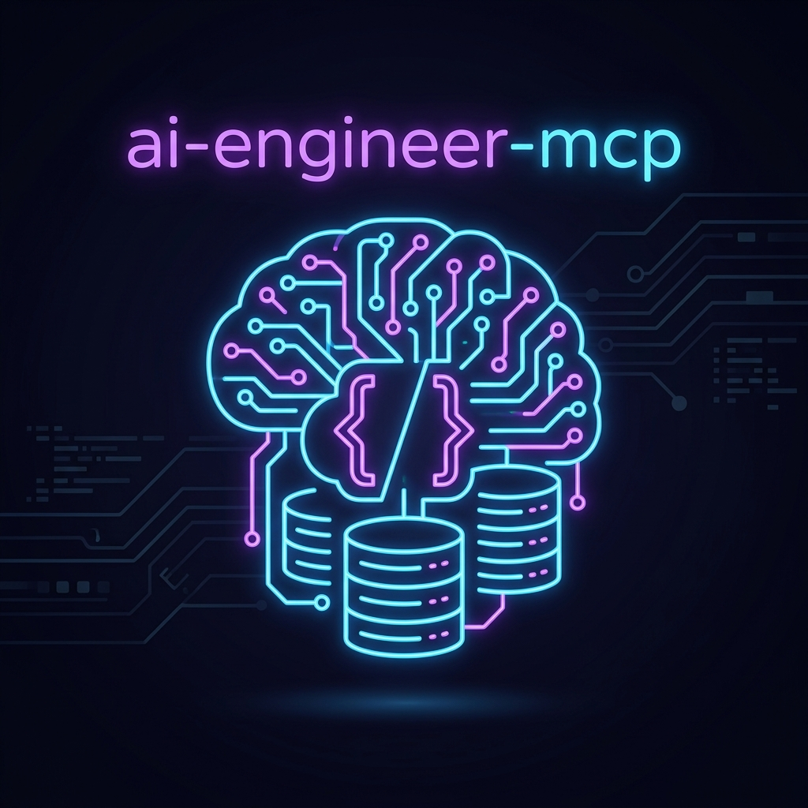

<div align="center">



# `ai-engineer-mcp` 🧠⚡
> *The 100% offline, local Model Context Protocol (MCP) server that supercharges your coding agent with expert AI Engineering patterns, RAG architectures, and agentic code.*

[](https://www.python.org/)
[](https://modelcontextprotocol.io/)
[](https://www.sqlite.org/fts5.html)
[]()

</div>

---

## 🚀 What is `ai-engineer-mcp`?

`ai-engineer-mcp` is a lightweight **Model Context Protocol (MCP) server** designed to run entirely locally. It indexes high-level engineering repositorie `ai-engineering-hub`—into an ultra-fast local SQLite FTS5 database, allowing your coding agent to instantly pull battle-tested architectural patterns, RAG pipelines, agent loops, vision, and audio snippets on demand via Stdio.

## 🛠️ Tech Stack
* **Protocol:** Model Context Protocol (MCP SDK via Stdio)
* **Language:** Python 3.10+
* **Storage & Search:** SQLite with FTS5 (Full-Text Search virtual tables & auto-sync triggers)
* **Environment:** 100% Offline / Local Edge Execution

---

## ⚡ Quick Start & Installation

### 1. Clone the repository
```bash
git clone https://github.com/Rengodz/ai-engineer-mcp.git
cd ai-engineer-mcp
```

### 2. Install Dependencies
```bash
pip install -r requirements.txt
```

### 3. Clone Your Reference Knowledge Base
Clone your reference repository locally inside the project folder:
```bash
git clone https://github.com/patchy631/ai-engineering-hub.git ./ai-engineering-hub
```

### 4. Run the Indexer
Ingest and index all engineering patterns, scripts, and markdown files into your local SQLite database:
```bash
python src/indexer.py ./ai-engineering-hub
```

---

## 🔌 IDE Integration (`mcp.json`)

To connect `ai-engineer-mcp` to your local assistant or IDE (like Claude Desktop, Cursor, or your custom agent workflow via Stdio), add the following configuration to your `mcp.json`:

```json
{
  "mcpServers": {
    "ai-engineer-knowledge": {
      "command": "python",
      "args": [
        "/absolute/path/to/ai-engineer-mcp/src/server.py"
      ]
    }
  }
}
```

---

## 💡 Available MCP Tools

### `search_knowledge`
Queries the local SQLite FTS5 knowledge base for expert implementation patterns.
* **Input Parameters:**
  * `query` *(string, required)*: Concept or keywords (e.g., `'GraphRAG'`, `'agent loop'`, `'prompt caching'`, `'multimodal'`).
* **Returns:** Formatted markdown excerpts matching the top relevant reference files and source code.

---

## 🛡️ Sovereign & Offline First
Designed for edge hardware (`ai-engineer-mcp` ensures zero data leaks, blazing-fast local queries, and deep contextual awareness for your autonomous developer agents without relying on cloud services.

---

## 📝 License
Distributed under the MIT License. See `LICENSE` for more information.